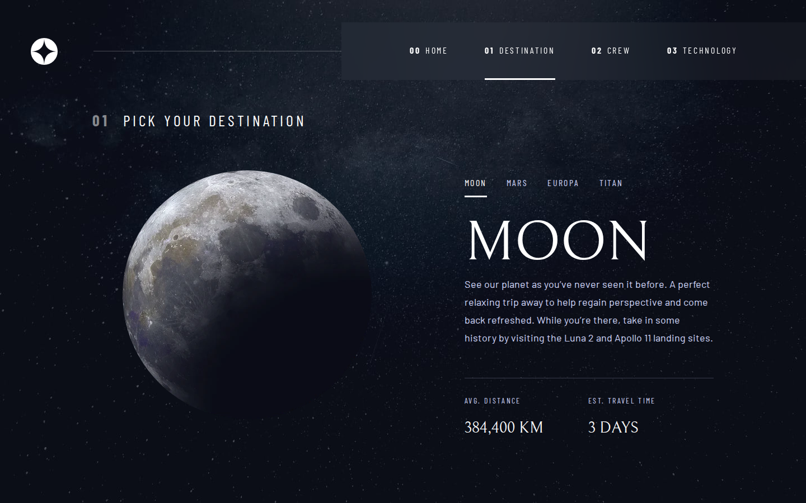
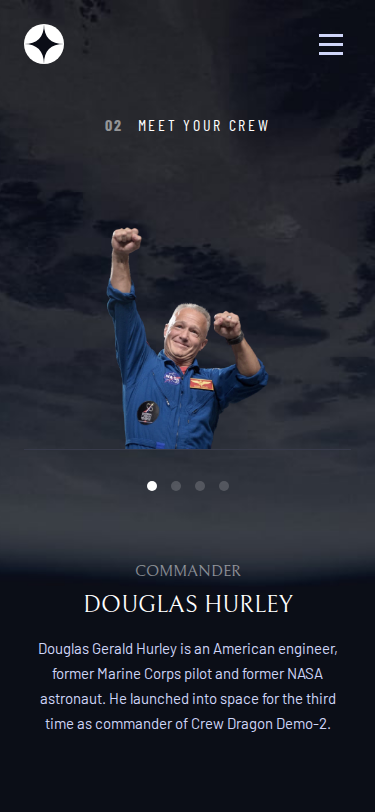

# Frontend Mentor - Space tourism multi-page website solution

This is a solution to the [Space tourism multi-page website challenge on Frontend Mentor](https://www.frontendmentor.io/challenges/space-tourism-multipage-website-gRWj1URZ3).

## Table of contents

- [Overview](#overview)
  - [The challenge](#the-challenge)
  - [Screenshots](#screenshots)
  - [Links](#links)
- [My process](#my-process)
  - [Built with](#built-with)
  - [What I learned](#what-i-learned)
  - [Quality checks](#quality-checks)
  - [Continued development](#continued-development)
  - [AI collaboration](#ai-collaboration)
- [Author](#author)

## Overview

### The challenge

Users should be able to:

- View the optimal layout for each of the website's pages depending on their device's screen size
- See hover states for all interactive elements on the page
- View each page and be able to toggle between the tabs to see new information

### Screenshots

| Desktop (1440px), destination page | Mobile (375px), crew page |
| --- | --- |
|  |  |

### Links

- Solution URL: [github.com/delfinjfb/frontendmentor-space-tourism-multipage](https://github.com/delfinjfb/frontendmentor-space-tourism-multipage)
- Live site URL: to be added after deployment

## My process

### Built with

- Semantic HTML5: one `h1` per page, `nav` landmarks with labels, `aria-current="page"` on the active tab
- CSS custom properties, Flexbox and CSS Grid (grid template areas reorder content per breakpoint)
- Mobile-first, two breakpoints (768px and 1024px)
- `<picture>` with WebP sources and PNG fallback, and a portrait/landscape switch on the technology pages
- A few lines of vanilla JavaScript, only for the mobile menu
- Twelve static pages: tabs are plain links, so every destination, crew member and technology has its own URL and works without JavaScript

### What I learned

**Pages as links, not tabs.** The brief allows either a JavaScript tab switcher or separate pages. I used separate pages: the browser's back button, deep links and no-JS support come for free, and the tab markup is a `nav` of links rather than an ARIA `tablist` that needs arrow-key handling.

**A grid bug worth remembering.** On the crew page the layout order differs by breakpoint (mobile: image, dots, text; tablet: text, dots, image; desktop: two columns). I first gave the heading its own `grid-area` and left the paragraph without one, so the paragraph was auto-placed in a new implicit row. Wrapping the heading and paragraph in one `.crew-text` element that owns the `text` area fixed it, and `display: contents` on the outer wrapper lets the dots, image and text be placed independently.

```css
.main-crew { display: grid; grid-template-areas: "title" "image" "dots" "text"; }
@media (min-width: 48em) { .main-crew { grid-template-areas: "title" "text" "dots" "image"; } }
```

**The mobile menu without trapping keyboard users.** The closed panel uses `visibility: hidden`, so its links are not focusable off-screen. Escape closes it and returns focus to the toggle button, and the toggle exposes `aria-expanded`. A `js` class on `<html>` keeps the menu visible when JavaScript is off.

### Quality checks

- No horizontal scroll at 320, 599, 600, 767, 768, 1023, 1024, 1440 and 1920px on the four page types checked (home, destination, crew, technology).
- Contrast, computed (WCAG AA needs 4.5:1 for small text): body text `#d0d6f9` on `#0b0d17` is 13.53:1; white is 19.37:1; the faded crew role (50% white) is 5.33:1. The design fades the `01`/`02`/`03` title numbers to 25% (2.19:1); I raised them to 50% (5.33:1) and kept the look.
- Keyboard: the skip link, menu toggle, tabs, dots and numbers all take a visible `:focus-visible` outline; Escape closes the mobile menu.
- Honest gap: the design lives in a Figma file I could not open here, so colours, font sizes and spacing come from the `preview.jpg` image and the published challenge specification, not from the Figma inspector. Expect small pixel differences.

### Continued development

- Generate the twelve pages from `data.json` at build time instead of keeping them as hand-maintained static files.
- Self-host the three Google Fonts to remove the third-party request.
- Compare the result with the Figma file in the inspector and tighten spacing.

### AI collaboration

I used Claude Code (Anthropic) to scaffold the project, generate the twelve HTML pages from the starter's `data.json`, and write the first pass of the CSS. I reviewed the output in the browser at three widths against `preview.jpg`, and the layout bug and the contrast failure above were found that way, not assumed away. What worked: fast scaffolding and repetitive page generation. What needed my judgement: grid placement per breakpoint, accessibility choices, and checking the numbers.

## Author

- GitHub - [@delfinjfb](https://github.com/delfinjfb)
